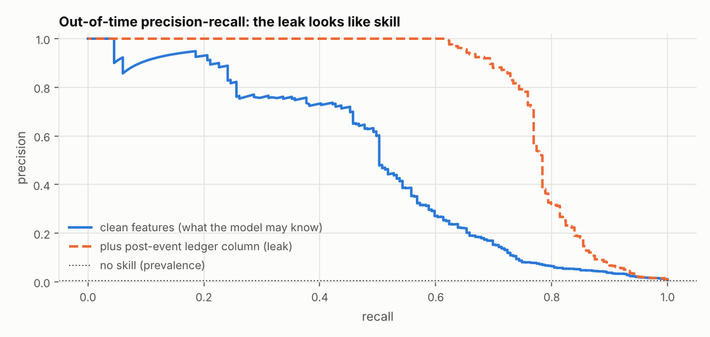
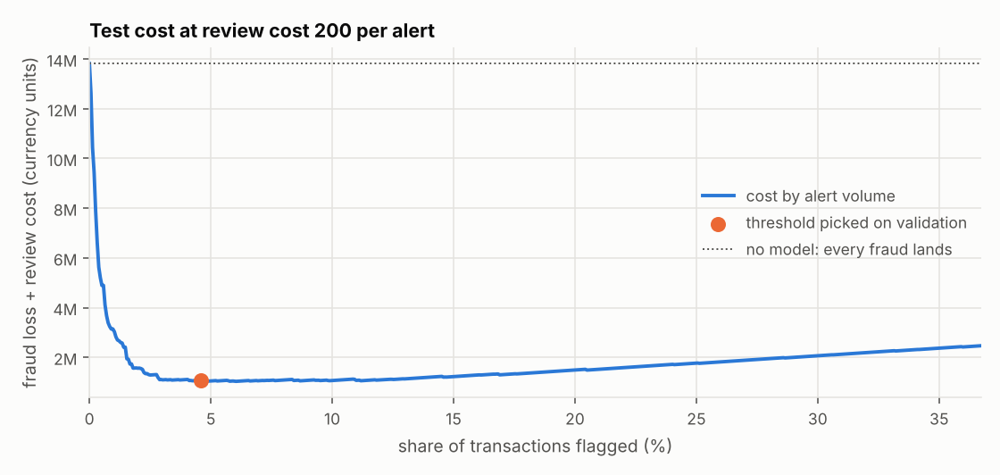

# Payment fraud: what a fraud model is allowed to know, and what a review costs

A fraud score is only useful if it can be computed before the payment is authorised, and only worth
deploying if flagging beats doing nothing after paying for the analysts. This repository builds a fraud
model around those two constraints on a PaySim-layout transaction table: point-in-time features, a
split that respects the delay before a fraud label exists, and an alert threshold picked by cost on
validation data.

> **Data status: synthetic.** The bundled CSV is generated in the PaySim column layout, with night-time
> drains of large balances into reused destination accounts built in on purpose, plus one deliberate
> leak. Every number below describes that synthetic data, not real transactions. The real PaySim file
> drops in unchanged: see [Use the real data](#use-the-real-data).

## Result

<!-- RESULTS:START -->
**Data: SYNTHETIC** (300,000 transactions, 129,497 in scope, 750 fraud = 0.58% of in-scope)

Split by time, label delay 48h: fit 56,171 rows (306 fraud), validation 23,711 (139), test 32,688 (199); 16,927 rows purged at the two boundaries.

| Model (test, out of time) | PR-AUC | 95% interval | ROC-AUC | Fraud in top 1% by score |
|---|---|---|---|---|
| gradient boosting (selected on validation) | 0.492 | 0.419 to 0.566 | 0.954 | 56.8% |
| logistic | 0.439 | 0.358 to 0.516 | 0.965 | 60.8% |

Test prevalence 0.61%: a model with no skill scores a PR-AUC near that.

Operating point: threshold chosen on validation only; the middle row is the default review cost (200 per alert).

| Review cost | Alerts | Alert rate | Recall | Precision | Cost with model | Cost, no model | Cost, amount rule | Saving |
|---|---|---|---|---|---|---|---|---|
| 50 | 4,807 | 14.71% | 90.5% | 3.7% | 483,378 | 13,818,336 | 10,459,129 | 13,334,958 |
| 200 | 1,501 | 4.59% | 73.9% | 9.8% | 1,078,186 | 13,818,336 | 10,460,779 | 12,740,150 |
| 800 | 1,086 | 3.32% | 71.9% | 13.2% | 1,749,396 | 13,818,336 | 10,467,379 | 12,068,940 |

**Leak trap.** Adding the post-event ledger column (`error_balance_dest`) lifts gradient boosting from PR-AUC 0.492 to 0.787. That gain is the generator's artefact, not skill, and it is excluded from every number above (selected model: PR-AUC 0.492).
<!-- RESULTS:END -->





### What to take from it

- **The leak is worth more than the model.** One column that records the ledger after the event lifts
  PR-AUC far above anything the clean features reach, and it would be absent in production. The guard
  (`features.LEAKY`) and the ablation exist so that a number like that is never reported by accident.
- **Precision-recall, not accuracy.** Fraud is a fraction of one percent of in-scope rows, so a model that
  flags nothing is over 99% accurate.
- **The threshold is a business input.** The three review costs give three different alert volumes from
  the same model. The cost-optimal cut flags a few percent of transactions at a low precision, because a
  missed fraud is many times larger than a review. That ratio is an assumption in this synthetic data and
  is the first thing to replace with real figures.
- **The amount rule is a real baseline, not a straw man.** It flags TRANSFERs over 200,000: 11 alerts in
  the test block, about 4% of fraud cases but roughly a quarter of the fraud value, because the large
  drains are the ones it sees. The model removes most of the rest of the loss, and that gap is what it has
  to justify.
- **Test intervals are wide.** About 200 fraud rows sit in the test block, so the 95% interval on PR-AUC
  is roughly 0.15 wide and the two models' intervals overlap. The ranking of logistic regression and
  gradient boosting is not settled by this run.

## How it works

```
CSV (PaySim layout)
  -> contract.validate        all violations reported at once, exit code 2
  -> features.build           time-ordered; counts use only earlier rows; confirmed-fraud count honours the 48 h delay
  -> model.evaluate           fit | purge | validation | purge | test, scoring TRANSFER and CASH_OUT only
  -> cost.best_cut            threshold chosen on validation, applied once to test
  -> reports/metrics.json + docs/img/*.png + README block (generated)
```

Decisions are written down: [ADR-001](docs/adr/001-scope-and-leakage.md) (scope and leakage),
[ADR-002](docs/adr/002-split-and-threshold.md) (split and threshold), the
[data contract](docs/data_contract.md) and [metric definitions](docs/metrics.md).

| Control | Where | What it catches |
|---|---|---|
| Leakage guard | `features.assert_no_leakage`, tested | A forbidden column entering the feature list |
| Point-in-time test | `tests/test_features.py` | A feature that peeks at later rows: cut the table, earlier features must not move |
| Confirmation delay | `features._confirmed_fraud_prior`, boundary test (57 h no, 58 h yes) | Using a fraud label before it could be known |
| Purged time blocks | `model.temporal_split`, boundary tests | Training or tuning on labels from the next block's future |
| Shuffled-label control | `tests/test_model.py` | Any leak: PR-AUC must fall to about the prevalence |
| Threshold-on-validation test | `tests/test_model.py` | Rewriting test labels must not move the threshold |
| Leak ablation | `model.evaluate` (`ablation_with_ledger_artefact`) | Shows the size of the trap rather than asserting it |
| README sync check | `make readme-check` | Numbers in this file drifting from `reports/metrics.json` |

## Run it

Needs Python 3.10 or newer. No database and no accounts.

```bash
git clone https://github.com/qasimrazamalik-coder/fraud-analytics fraud-analytics && cd fraud-analytics
make setup                 # creates .venv and installs requirements.txt
source .venv/bin/activate
make data                  # writes data/raw/paysim_like.csv (300,000 rows, seed 42)
make run                   # validates, evaluates, writes reports/metrics.json and docs/img
make readme                # refreshes the results block above from the metrics
make verify                # lint + tests + README sync check
```

Runtime on a laptop: the full run is about 15 seconds; the test suite is under a minute.

### Use the real data

1. Download PaySim from Kaggle (`ealaxi/paysim1`, file `PS_20174392719_1491204439457.csv`) and place it
   as `data/raw/paysim.csv`. The column layout is the one this project is built on.
2. `make run CSV=data/raw/paysim.csv PROV=real`, then `make readme`.
3. Read the numbers again before reusing any sentence above: the "What to take from it" section describes
   the synthetic run. In the real file almost every account appears once, so the account-history features
   will carry little, and the size of the ledger leak has to be measured there, not assumed.

## What was verified and what was not

| Item | Status |
|---|---|
| Unit tests (hand-computed expectations, boundary cases, shuffled-label control) | Run locally, all pass |
| Lint (`ruff`) | Run locally, clean |
| Mutation check: 12 deliberate bugs in split, features, cost and contract code | 12 caught after one survivor got its test (see `tests/test_report.py`) |
| Figures | Rendered and looked at after the last change; one defect (empty chart) found and fixed that way |
| CI workflow | Written, not yet run on GitHub |
| Real PaySim | Not run. Everything above is synthetic |
| Python versions other than the one used locally | Not tested; CI targets 3.12 |

## Layout

```
src/fraudlab/   synth, contract, features, model, cost, report, readme_sync, cli
tests/          features, split, cost, contract, synth, model, report, readme sync
docs/           data_contract.md, metrics.md, adr/, img/
reports/        metrics.json (generated)
```

## Limits

- Balances in the synthetic data are drawn per transaction, not carried through an account ledger.
- The review cost, the 48 hour label delay and "a flagged fraud is stopped in full" are assumptions.
  The savings figure is therefore an upper bound.
- No dbt layer: the features are computed in pandas. At warehouse scale the same rules would move into
  SQL, with the boundary tests here as the specification.

MIT licence.
